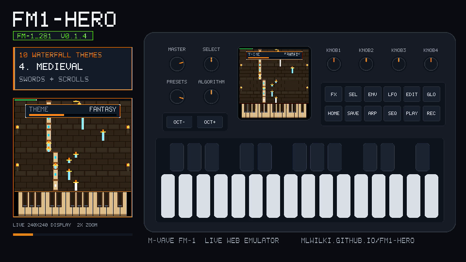
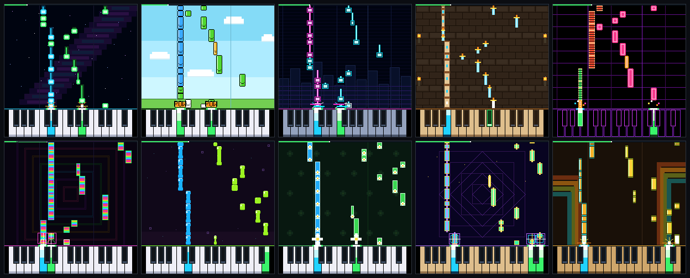
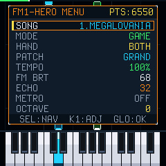

<div align="center">

# FM1-Hero


**Falling-note MIDI piano trainer, rhythm game, 10-theme full-screen visualizer, and 6-voice 2-operator FM synthesizer for the M-VAVE FM-1.**

[](https://mlwilki.github.io/FM1-Hero/#install)
[](https://mlwilki.github.io/FM1-Hero/#emulator)
[](https://youtu.be/yYpGUNg_7zo)
[](https://mlwilki.github.io/FM1-Hero/#rescue)

[](LICENSE)
[](https://github.com/konsumer/foma)
[](firmware.json)

</div>

---

Play along with falling **Right Hand** and **Left Hand** notes across an edge-to-edge 240×240 full-screen waterfall while the physical keybed LEDs light up the next notes to press.

## 60-Second Demo Video

<div align="center">
  <a href="https://youtu.be/yYpGUNg_7zo">
    
  </a>
  <p>
    <a href="https://youtu.be/yYpGUNg_7zo"><strong>▶ Watch on YouTube</strong></a> ·
    <a href="docs/demo.mp4">Download MP4 (5.8 MB)</a>
  </p>
</div>

## 10 Visual Waterfall Themes & `GLO` Menu

Switch live between **10 procedural full-screen waterfall themes** using the **`PRESETS`** knob (or **`SEQ`** button), and open the clean modal **FM1-Hero Menu** anytime with **`GLO`**:



*Top row: **1. Outer Space** · **2. Cartoon** · **3. Cyberpunk / Neon** · **4. Medieval / Fantasy** · **5. Retro / Arcade***  
*Bottom row: **6. Tie-Dye / Blacklight** · **7. Lava Lamp** · **8. Flower Power** · **9. Cosmic Mandala** · **10. 70s Groovy***

<details>
<summary><strong>Preview: GLO Modal Menu Window</strong></summary>
<p align="center"></p>
</details>

## Install on Your FM-1

1. Open the **[FM1-Hero Web Installer](https://mlwilki.github.io/FM1-Hero/#install)** in **Chrome** or **Edge**.
2. Connect your M-VAVE FM-1 directly to your computer with a USB data cable and close any other MIDI apps.
3. Click **Install** and wait for the FM-1 to finish writing and reboot.

> **Prefer the command line?** Run `./fm1 build && ./fm1 flash` (see [Build & Develop](#build--develop)), or try the **[Browser Emulator](https://mlwilki.github.io/FM1-Hero/#emulator)** first — no hardware required.

## Features

- **10 Full-Screen Procedural Themes (`PRESETS` knob / `SEQ` button):** Edge-to-edge waterfall with custom themed backgrounds, notes, strike-line impacts, and keyboards — saved to flash.
- **Clean `GLO` Modal Menu Window:** Zero permanent top/bottom bars cluttering the display; press `GLO` anytime to adjust Song, Theme, Mode, Hand, Patch, Tempo, FM Brightness, Echo, Metronome, and Octave.
- **3 Practice & Game Modes** (`ALGORITHM` encoder or `SEL` / `ARP` buttons):
  - **WAIT (Melody Practice):** Scrolls to the next note and pauses until you press the lit key(s).
  - **GAME (Rhythm Practice):** Continuous waterfall with `PERFECT!`, `GREAT!`, `GOOD`, and `MISS` timing judgements, combo multipliers (`x2`, `x3`, `x4`), and staggered end-of-song grades (`S`, `A`, `B`, `C`).
  - **AUTO (Watch & Listen):** Jukebox mode that plays the full song automatically while letting you improvise along on the keys.
- **Hand Separation (`ENV` / `LFO` buttons):**
  - **BOTH:** Play both Left Hand and Right Hand parts.
  - **RH (Right Hand):** Practice the Right Hand while the Left Hand accompaniment plays automatically.
  - **LH (Left Hand):** Practice the Left Hand while the Right Hand melody plays automatically.
- **True Slow Practice (`KNOB 1`):** Sub-millisecond fractional tempo scaling from **15% to 200%** plus **A–B Section Looping (`EDIT` button)**.
- **16 Built-in Songs + 163-Song Web Library & Custom `.MID` Slot 17 (`SELECT` encoder):**
  - Includes 16 built-in songs plus a **163-song web library** and drag-and-drop `.mid` uploader (up to **8,192 notes** in RAM) in the [browser emulator/installer](https://mlwilki.github.io/FM1-Hero/#emulator).
- **Live Song Recorder (`REC` button):** Record your own melodies directly from the 27 keys or USB/TRS MIDI input into Custom Slot 17.
- **6-Voice 2-Op FM Synth + Stereo Ping-Pong Echo:**
  - 6 patches (`GRAND PIANO`, `DX E-PIANO`, `CHIPTUNE`, `FM BELLS`, `SYNTH BRASS`, `CRYSTAL PAD`), adjustable FM brightness, and stereo ping-pong delay.
- **Hardware Compatibility:** Supports newer `B36014` flash chips and macOS 13–15 USB audio descriptor ordering.

## Controls Cheat Sheet

| Control | Function |
| :--- | :--- |
| **27 Keys / MIDI In** | Play notes & hit falling **Right Hand** and **Left Hand** notes |
| **Key LEDs** | Light up the physical keys you need to press next |
| **PLAY** | Play / Pause song (or retry from the Recital Complete screen) |
| **HOME** | Rewind song to Measure 1 |
| **SELECT** | Browse 16 built-in songs + Slot 17 (or navigate rows inside the `GLO` Menu) |
| **PRESETS / SEQ** | Switch between all 10 Visual Waterfall Themes (`SPACE`, `CARTOON`, `CYBER`, `FANTASY`, `ARCADE`, `TIEDYE`, `LAVA`, `FLOWER`, `MANDALA`, `70S`) |
| **ALGORITHM / SEL** | Cycle Mode: `WAIT` (Wait-for-Me), `GAME` (Rhythm), `AUTO` (Watch) |
| **ENV / LFO** | Cycle Hand Practice: `BOTH`, `RH` (Right Hand), `LH` (Left Hand) |
| **EDIT** | A–B Loop Bookmark (1st press = set A, 2nd = loop A–B, 3rd = clear) |
| **GLO** | Open / Close **FM1-Hero Menu** window (Song, Theme, Mode, Hand, Patch, Tempo, FM, Echo, Metronome, Octave) |
| **FX / KNOB 2** | Cycle 6 FM Synth Patches (`GRND`, `EPNO`, `CHIP`, `BELL`, `BRAS`, `PAD`) |
| **KNOB 1** | Song Tempo / Speed (`15%` – `200%`), or adjust selected value inside the `GLO` Menu |
| **KNOB 3** | FM Brightness / Timbre (`0` – `127`) |
| **KNOB 4** | Stereo Echo FX Mix (`0` – `127`) |
| **OCT- / OCT+** | Transpose keyboard octave (`-2` to `+2`) |
| **REC** | Record live playing into Custom Slot 17 |
| **SAVE** | Save high scores, settings, theme, and custom song (up to 900 notes) to internal flash |

## Flash Storage & Rescue

- **Saving (`SAVE` button):** High scores, settings, selected theme, and up to 900 notes of your custom recorded/uploaded `.mid` song are stored in the user flash area (`0xFB000`, `4 KiB` max via `settings_save()`). Full-length custom `.mid` uploads (up to 8,192 notes) play completely in RAM.
- **Project / Sample Compatibility:** FM1-Hero uses its own flash layout and **cannot read other firmwares' saved projects, patches, or samples**. Installing another firmware that uses the same user flash region (`0xFB000`) may overwrite saved scores and custom recordings.
- **USB Rescue:** Installing firmware is at your own risk. If the FM-1 ever fails to start, hold **OCT-** while switching the power on to enter *USB RESCUE* mode, then reinstall from the **[Web Installer](https://mlwilki.github.io/FM1-Hero/#install)** or restore the official M-VAVE firmware (V15 or V16) from the **[Rescue tab](https://mlwilki.github.io/FM1-Hero/#rescue)**.
- **Deeper Recovery:** See [The Firmware Hub FM-1 Rescue Guide](https://thefirmwarehub.com/tools/rescue/) if USB Rescue does not start.

## Build & Develop

```sh
./fm1 dev          # http://localhost:8000 — live emulator, WebMIDI .mid uploader, USB installer & rescue
./fm1 build        # builds build/web/ (site + firmware.wasm + firmware.fwsc) and build/fm1-hero-0.1.4.fwsc
./fm1 flash        # flashes build/web/firmware.fwsc to a connected FM-1 over USB
```

## License

**GPL-3.0-only** ([LICENSE](LICENSE)). Credits and third-party components are documented in [LICENSING.md](LICENSING.md).
